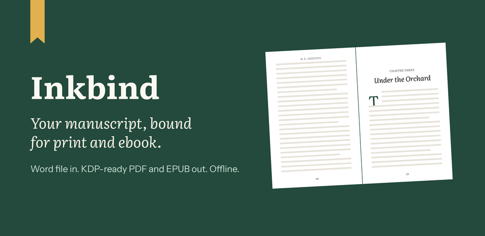
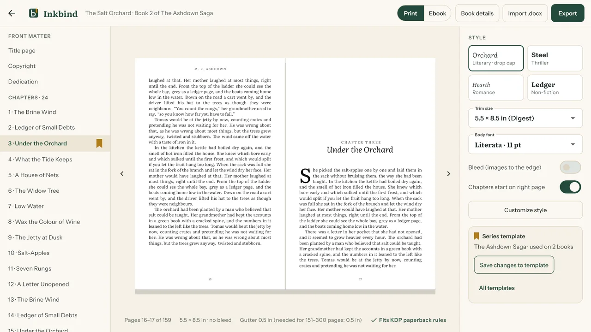
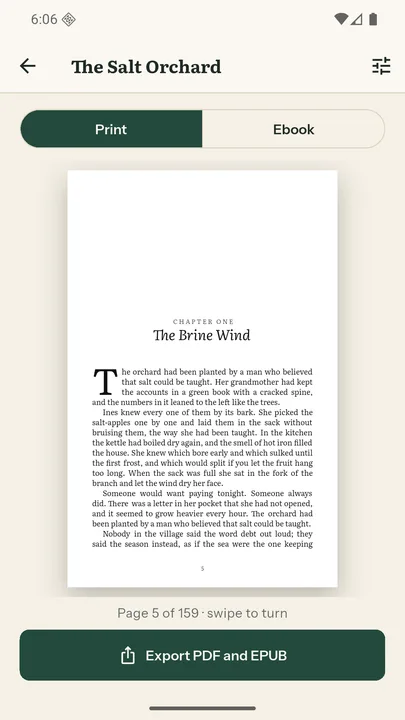
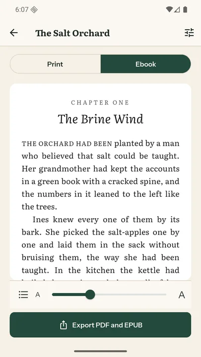
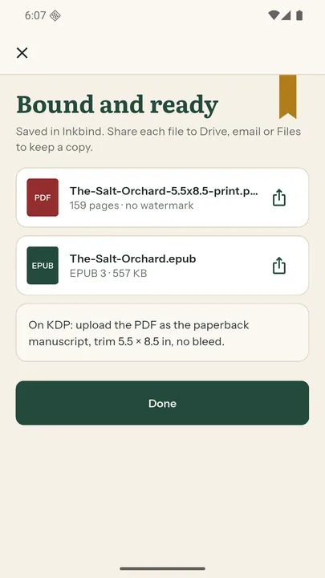
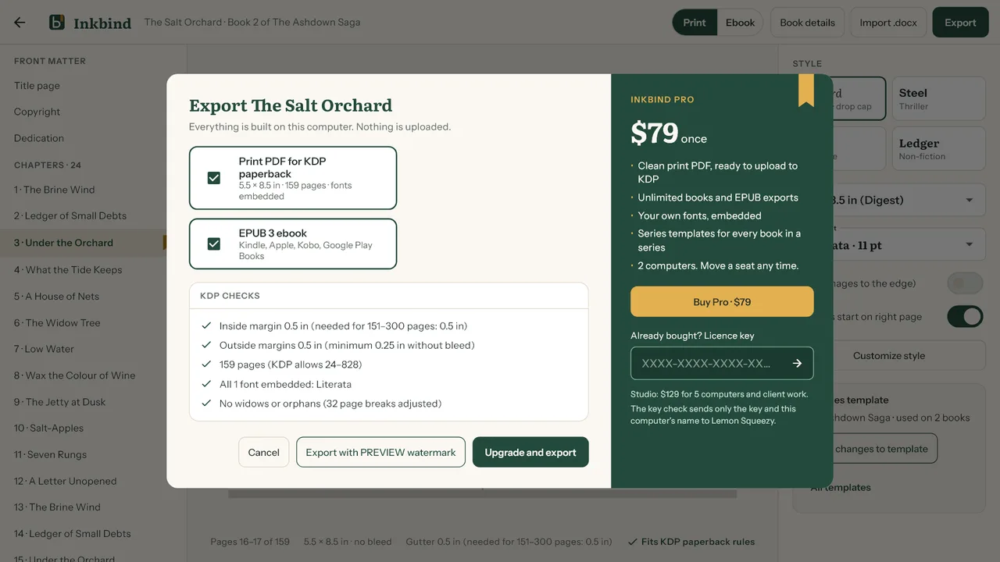

# Inkbind: Book Formatter for Windows and Android

Inkbind turns a Word manuscript into a print-ready book PDF for Amazon KDP paperbacks and an EPUB for every ebook store. It runs fully offline on your Windows PC or Android phone, with no account and no subscription.

[Get it from Microsoft](https://apps.microsoft.com/detail/9P317ZQH835T) · [Get it on Google Play](https://play.google.com/store/apps/details?id=com.inkbindapp.inkbind) · [Website](https://inkbind.pages.dev/)

## What it does

- **Imports your .docx.** Headings become chapters; italics, bold, scene breaks and quotes come across. An import review shows every chapter found and anything it couldn't keep.
- **Shows real pages as they print.** The two-page preview matches the exported PDF: chapters on right-hand pages, drop caps, running heads, page numbers, and no widows or orphans.
- **Follows KDP's paperback rules.** Every common trim size from 5 × 8 to 7 × 10 inches, bleed on or off, and an inside margin that grows with the page count. A checklist runs before each export, and every font is embedded.
- **Builds the ebook too.** EPUB 3 with a clickable table of contents, embedded fonts and series details.
- **Keeps a series consistent.** Save a series template and the next book gets the same look in one click. Bring your own .ttf or .otf fonts (Windows Pro).
- **Stays on your device.** Your manuscript is never uploaded. Only the Windows licence check goes online.

## Pricing

- **Windows:** free to try (preview everything, EPUB for one book, watermarked PDF proofs). Pro is $79 once for two computers; Studio is $129 once for five computers and client work. [See pricing](https://inkbind.pages.dev/#pricing).
- **Android:** free with ads. EPUB export is always free; one short video exports a clean print PDF.

## Screens

| Android print preview | Android ebook view | Android export |
|---|---|---|
|  |  |  |

Videos: [Windows demo](https://youtu.be/sn-C4lMBiHs) · [Android teaser](https://youtube.com/shorts/K67lYuXTjv8)

## Links

- Website: https://inkbind.pages.dev/
- Privacy policy: https://inkbind.pages.dev/privacy/
- Support: anithabheesetty@gmail.com

This repository is the product page for Inkbind. The app's source code is not published here.
